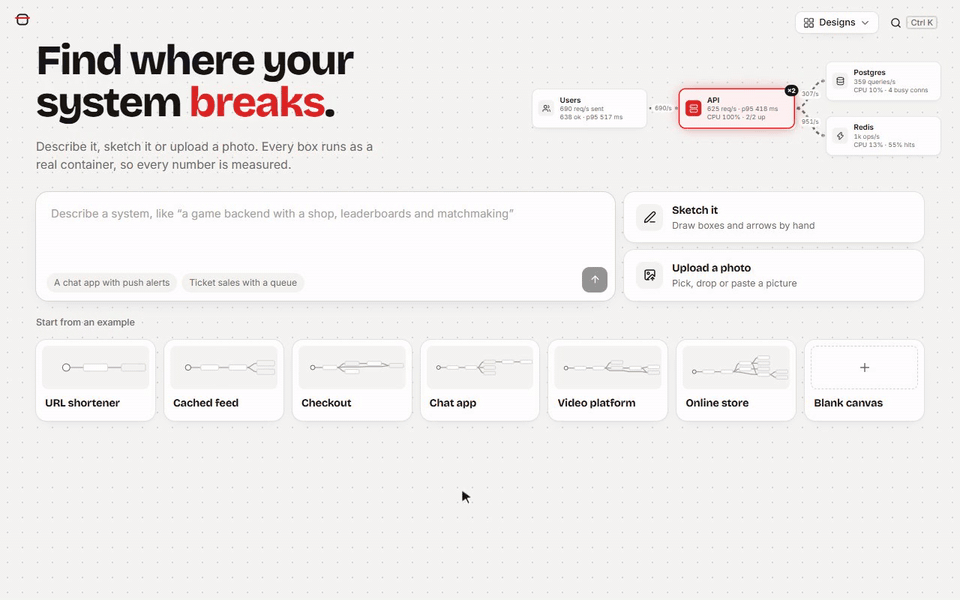
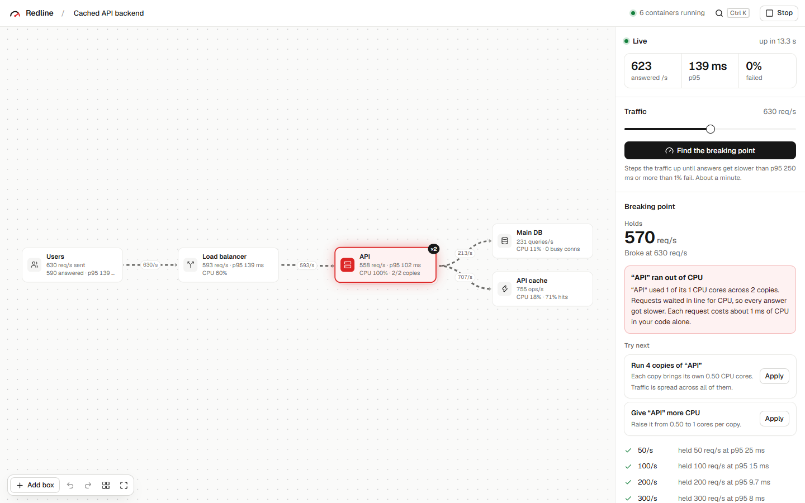
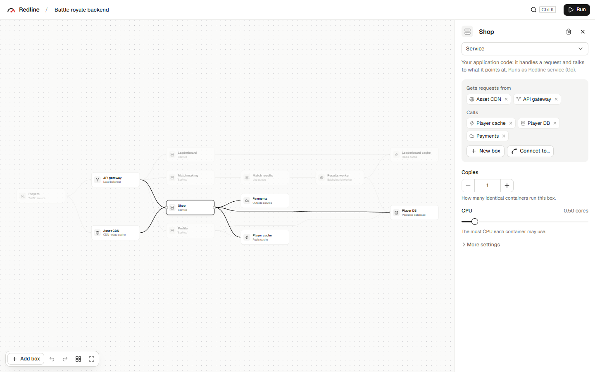

# Redline

**Describe or sketch a backend. Redline runs it in real containers and pushes traffic until it breaks.**



You describe a system in a sentence, sketch it on a pad, or photograph a whiteboard: boxes for users, an API, a cache, a
database, with arrows between them. Redline draws it, starts each box as a real container in Docker, sends more and more
traffic, and tells you which box gave out first and why. Then it suggests a fix, you apply it, run again, and compare.

## What happens, step by step

Take **Users → API → Postgres**.

1. **Draw.** Type it (“users hit an API backed by Postgres”), sketch it, or drop a photo. Claude turns it into boxes and
   arrows in about 4 seconds. From a sentence you get a full design with a short title, laid out left to right in the
   order requests flow. From a photo the boxes sit on top of your drawing, so you can check them. Every box ends up
   connected: one that nothing reaches gets an arrow from its likeliest caller, and Redline says so.
2. **Run.** Each box becomes a container. Postgres is real PostgreSQL 17 and a cache is real Redis. Your API, load balancers and
   workers are a small Go program that does what those boxes do. The API, for example, checks the cache, falls back to the
   database, and fills the cache after a miss. Every container gets a CPU limit (0.5 cores for a service by default).
   This stack is ready in about 8 seconds.
3. **Break.** Redline sends traffic in steps: 50, 100, 200, 300, 500 requests a second, and so on. Each step must keep 95% of
   answers under your target (250 ms by default) with under 1% failing. Here, 400 req/s passes and 450 doesn't. Redline
   then looks at what every container was doing at that moment and says: **“API” ran out of CPU. It used 0.50 of its 0.50
   cores, and each request costs about 1 ms of CPU.**
4. **Fix and compare.** It suggests **Run 2 copies of “API”** or **Give “API” more CPU**. Press Apply, run again, and
   compare. With 3 copies the same test holds **1,200 req/s**, three times as much. A cache wouldn't have helped here, because the database was never the problem. Shrink Postgres to a
   fifth of a core and run 6 API copies, and Redline blames Postgres instead; then its suggested cache takes the system
   from 1,000 to 2,000 req/s.

<picture>
  <source media="(prefers-color-scheme: dark)" srcset="docs/img/live-dark.png">
  
</picture>

## Editing

<picture>
  <source media="(prefers-color-scheme: dark)" srcset="docs/img/editor-dark.png">
  
</picture>

Click a box to see what it's connected to, rename it, or change what it is. Its main settings (copies and CPU for a
service) are up front, the rest under “More settings”. To grow a design:

- **New box** in the box's panel adds one already connected to it, beside it.
- **Drag from the dot on a box's side** to another box to draw an arrow, or let go on empty canvas to pick a new box
  that appears right there, connected.
- **Connect to…** joins two boxes that are already there, in whichever direction requests can flow.
- **Tidy up** lines everything up again. Arrows always find their way between boxes, never through them.

There are seven examples to start from: a URL shortener, a cached feed, checkout, a chat app, a video platform, an online
store and a battle royale game backend, plus a blank canvas. **Ctrl K** finds every command.

## How this differs from a system design simulator

Tools like Breakscale, Backpressure and Chinilla are good for building intuition. They calculate what *would* happen from
formulas and numbers you type in. Redline measures what *does* happen.

| | Simulators | Redline |
| --- | --- | --- |
| Where the numbers come from | A queueing model in the browser | Real Postgres, Redis and Go services under load |
| Start from | Dragging boxes onto a canvas | A photo of your whiteboard (or a canvas, a sketch pad, or a sentence) |
| Database speed | A number you enter | Whatever Postgres actually does with 100,000 rows |
| Cache hit rate | A percentage you enter | Measured, from real popular-item traffic |
| Needs | A browser | Docker on your computer |

## Run it

You need [Node.js](https://nodejs.org) 22.18 or newer and [Docker Desktop](https://www.docker.com/products/docker-desktop/)
running. To read drawings, either sign in to [Claude Code](https://claude.com/claude-code) (`claude` on your PATH; no API
key needed) or put `ANTHROPIC_API_KEY=...` in a `.env.local` file. The examples work without either.

```bash
npm install
npm start
```

Open http://127.0.0.1:4600. The first run builds Redline's runtime image and downloads Postgres and Redis (about a minute);
later runs start in seconds. Press **Ctrl K** for every command.

Settings, all optional, in the environment or `.env.local`:

| Setting | What it does |
| --- | --- |
| `REDLINE_PORT` | The port, 4600 by default |
| `REDLINE_DATA` | Where designs, photos and test results are kept, `.redline/` by default |
| `REDLINE_AI` | `cli` (Claude Code), `api` (your API key) or `off`. By default the CLI if it's there, otherwise the key |
| `REDLINE_MODEL` | The model that reads drawings, `claude-opus-5-5` by default |

## How it works

```
 Browser (React)                Redline server (Node)                    Docker
 ┌───────────────┐  JSON, SSE   ┌──────────────────────────┐  compose   ┌─────────────────────────────────┐
 │ canvas, panel │ ───────────▶ │ read: photo → Claude     │ ─────────▶ │ probe ─▶ lb ─▶ api ×3 ─▶ redis  │
 │ live charts   │ ◀─────────── │ compile: design → compose│            │   │              └────▶ postgres│
 └───────────────┘              │ session: start, ramp,    │ ◀───────── │   └ scrapes every box each second│
                                │ analyze, suggest, save   │  stats     └─────────────────────────────────┘
                                └──────────────────────────┘
```

- **Reading** (`server/recognize.ts`). The photo is shrunk to the size Claude reads without rescaling, so the positions it
  returns line up with the picture. Claude answers in a fixed JSON shape (structured output): a short title, each box's
  label, kind, position and copy count, and each arrow. A description goes to a second prompt that designs a realistic
  system Redline can run: 6 to 13 boxes, only arrows that work, and nothing left floating. `shared/normalize.ts` then
  cleans it up: arrows drawn backwards are flipped (a database never calls an API), a worker's line to its queue becomes
  "takes jobs from", extra "Users" boxes merge, a Users box is added if there is none, and a box nothing reaches gets an
  arrow from the box whose name it shares (a "Skins CDN" finds the "Skins service").
- **Layout** (`shared/normalize.ts`, `shared/route.ts`). Each box goes in the column of its step along the longest request
  path, so every design reads users, then CDN and gateway, then services, then what they call. [dagre](https://github.com/dagrejs/dagre)
  orders each column to keep crossings down. Arrows cross a column of boxes level, through the gap nearest a straight
  line, and bend only in the open space between columns. Boxes read from a photo stay where they were drawn, nudged
  apart if they overlap.
- **Compiling** (`shared/compile.ts`). A design becomes a Docker Compose file: one service per box, `deploy.replicas` for
  copies, CPU and memory limits, health checks, and start order from the arrows. Nothing is published to your network
  except the probe, on 127.0.0.1.
- **The runtime** (`runtime/`, Go). One small binary plays every box that isn't a real database or cache:
  - *service*: does its CPU work, reads through each cache to each database, writes and clears caches, queues a job, and
    calls the services it points at. At most 64 requests run at once per copy, like a server's thread pool.
  - *load balancer*: round robin over every copy behind it, found through Docker's DNS.
  - *CDN*: an in-memory LRU cache in front of what it points at.
  - *worker*: takes jobs off a Redis Streams queue with a consumer group.
  - *external API*: a stand-in that answers after a set delay, like a payments provider.
  - *probe*: the load generator. It sends requests on a fixed schedule (request *n* is due at start + *n*/rate) and counts
    latency from when a request was *due*, not when it went out. That way a slow system can't slow the test down and hide
    its own delay. Every second it also collects each box's numbers: requests, latency histograms, database-connection
    waits, cache hits, Postgres transactions and queue backlog.
- **Finding the bottleneck** (`shared/analyze.ts`). The server adds each container's CPU use from Docker and scores every box:
  how close it is to its CPU limit, whether it waited for database connections, and whether its queue is growing. The box
  with the highest load at the step that failed is named, with the numbers behind it. A service that waits for
  connections *because* it's out of CPU is blamed for CPU, not connections.
- **Suggestions** (`shared/suggest.ts`) are changes to the design: more copies, more CPU, more database connections, a cache
  in front of a read-heavy database, or more workers for a queue that falls behind.

Everything you make is kept in a SQLite file: designs, photos, and every test with its per-second samples.

## Measured

**Reading drawings** ([eval/results.md](eval/results.md)): 48 synthetic hand-drawn sketches. Half are clean, and half are
tilted, blurred, JPEG-compressed photos with glare and decoys: a title, words on arrows, a sticky note, a crossed-out box.

| | All 48 | Clean 24 | Hard 24 |
| --- | --- | --- | --- |
| Read exactly right (every box, kind and arrow) | 95.8% | 100% | 91.7% |
| Boxes found / made up | 100% / 0 | 100% / 0 | 100% / 0 |
| Arrows right | 99.2% | 100% | 98.6% |
| Time per sketch (median) | 4.4 s | 4.2 s | 5.6 s |

Both misses are honest edge cases: a two-headed arrow between two services (either direction is defensible), and one
arrow lost where lines cross in an 8-box drawing. The sketches are generated (`eval/cases.ts`), not real photos.
`npm run eval` reruns it (about $1.50 of Claude usage); `npm run eval -- --report` re-scores saved answers for free.

**Breaking points on real containers** ([bench/results.md](bench/results.md)), on a 12-CPU Docker Desktop:

| Design | Containers | Ready in | Holds | Breaks at | What broke |
| --- | --- | --- | --- | --- | --- |
| URL shortener: 1 API copy, Postgres | 3 | 9.0 s | 400 req/s | 450 req/s | API ran out of CPU |
| … with 3 API copies | 5 | 8.5 s | 1.2k req/s | 1.3k req/s | API ran out of CPU |
| … with 3 API copies and a Redis cache | 6 | 9.3 s | 1k req/s | 1.2k req/s | API ran out of CPU |
| 6 API copies, Postgres limited to 0.2 CPU | 8 | 19.6 s | 1k req/s | 1.2k req/s | Postgres ran out of CPU |
| … with a Redis cache in front of Postgres | 9 | 20.3 s | 2k req/s | 2.3k req/s | API ran out of CPU |
| Cached feed: load balancer, 2 API copies, Redis, Postgres | 6 | 11.1 s | 750 req/s | 820 req/s | API ran out of CPU |
| Checkout: payments API, Postgres, queue and worker | 6 | 8.6 s | 300 req/s | 350 req/s | Mailer ran out of CPU |

Two things this shows. Adding copies scales the API in a straight line (400 → 1,200 req/s with 3 copies). And the cache
only helps when the database is what's full: in front of a small 0.2-CPU Postgres it doubles capacity (1,000 → 2,000 req/s,
and the bottleneck moves to the API), but next to a CPU-bound API it changes nothing. Redline names the right box both times.

The numbers compare designs with each other. Each box gets a slice of one laptop, not a server, so read them as
"3 copies hold 3× as much", not "your API will hold 1,200 req/s". Runs vary by about one step (1,000 vs 1,200) because the
containers share the machine.

## Limits

- **Scaled-down hardware.** Containers share your computer's CPU. If the boxes ask for more cores than Docker has, Redline
  warns you, and results get noisier.
- **A simple request.** Every request reads or writes one item by key, with popular items getting most traffic. Real apps
  do more varied work. Change the read/write mix, item count and per-request CPU to get closer.
- **External APIs are stand-ins** with a fixed delay. Search engines, object storage and read replicas aren't modelled yet.
- **Reading is checked on generated sketches.** Real photos are messier.

## Tests

| Command | What it checks |
| --- | --- |
| `npm test` | 85 unit and server tests: the model, compiler, layout, arrow routing (no arrow in any example touches a box), joining up stray boxes, analysis, suggestions, the step-up search, reading, and the HTTP server (with a stand-in runtime) |
| `npm run test:go` | The Go runtime: caching, writes, load balancing, the CDN, error reporting, and that the probe holds its rate |
| `npm run test:docker` | Real containers: writes reach Postgres, jobs reach the worker, the cache answers, and a suggested fix raises capacity |
| `npm run e2e` | 22 browser checks in Chrome against a test-mode server: every way in, adding and connecting boxes, a run, the fix, phone width (`npm run build` first) |
| `npm run typecheck` | TypeScript across the server, the page and the shared code |

`npm run bench` reruns the capacity table. `npm run media` records the demo GIF and the pictures above from a real run.
`npm run dev` starts the server and a hot-reloading page on port 4610.

## Layout

```
shared/    the design model, validation, layout and arrow routing, the compiler, analysis and suggestions (used by both sides)
server/    HTTP API, Docker, sessions, the step-up search, reading drawings, SQLite
runtime/   the Go program that plays services, load balancers, CDNs, workers, stand-ins and the probe
web/       the page: React, React Flow for the canvas, Vercel's UI SDK for menus, dialogs, sliders and toasts
eval/      the drawing-reading evaluation
bench/     the capacity benchmark
e2e/       browser checks
```

## Safety

Redline starts containers, so it only listens on 127.0.0.1. It refuses requests whose `Host` isn't its own (which stops DNS
rebinding), changes that come from another site, and anything that isn't JSON. The page runs under a strict Content
Security Policy. Compose files are built from a validated design, never from text Claude wrote: box names are reduced to
`a-z0-9-`, images are fixed, and containers get no volumes, no extra privileges and no published ports. Containers left
behind by a crash are removed the next time Redline starts.
